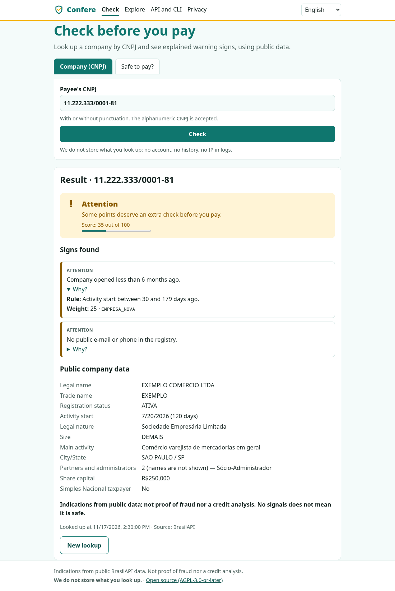

# Confere

**English** · [Português](README.md)

[](https://github.com/EttoreCSenatore/confere/actions/workflows/ci.yml)
[](LICENSE)
[](https://ettorecsenatore.github.io/confere/en/)

**Check before you pay.** A web app, API and CLI that cross-reference public data from [BrasilAPI](https://brasilapi.com.br/) (CNPJ, banks, Pix participants) and show **explained** warning signs, **without storing your lookups**.



## Try it in 2 minutes

```bash
git clone https://github.com/EttoreCSenatore/confere && cd confere
./scripts/dev.sh            # app at http://127.0.0.1:5173 (Python 3.13+ and Node 24+)
```

CLI: `pipx install "git+https://github.com/EttoreCSenatore/confere#subdirectory=cli"` then `confere cnpj 00000000000191`.

## What it does

- **Check a company (CNPJ)**: status, age, activity and explained signs ("Why?" shows the rule).
- **Safe to pay?**: CNPJ + bank/ISPB + Pix participation. It does not verify the Pix key holder.
- **Open-data explorer**: banks, Pix, municipalities, NCM and brokers, with search and CSV; it works from a weekly local copy, so it does not depend on BrasilAPI.
- Documented **CLI** and **API**, in Portuguese and English.

## Principles

- **Privacy by default (LGPD)**: no account, no history, no IP in logs. Artifacts in [`.lgpd/`](.lgpd/STATUS.md) (Portuguese, reviewed by AI, **no lawyer review**; not legal advice).
- **Explainable**: every signal shows the rule behind it. A hint, not proof of fraud.
- **Free software**: code AGPL-3.0-or-later ([LICENSE](LICENSE)); documentation CC BY-SA 4.0 ([LICENSE-DOCS.md](LICENSE-DOCS.md)).

## Development

```bash
cd api && python -m venv .venv && . .venv/bin/activate && pip install -e '.[dev]' && python -m confere   # API
cd web && npm ci && npm run dev                                                                   # interface
cd website && npm ci && npm start                                                                  # docs
```

See the [Development](https://ettorecsenatore.github.io/confere/en/docs/tecnico/desenvolvimento) page. Vulnerabilities: [SECURITY.md](SECURITY.md).
