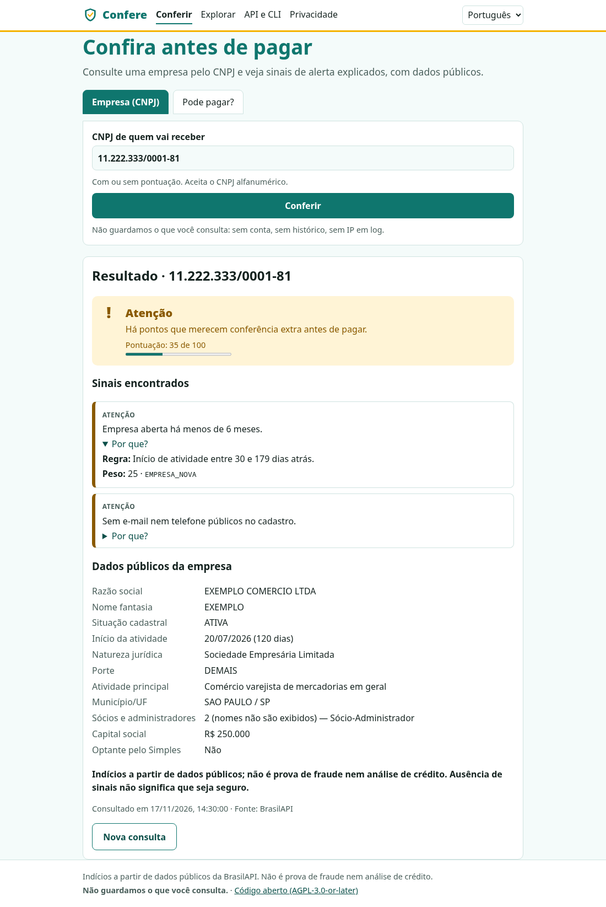

# Confere

[English](README.en.md) · **Português**

[](https://github.com/EttoreCSenatore/confere/actions/workflows/ci.yml)
[](LICENSE)
[](https://ettorecsenatore.github.io/confere/)

**Confira antes de pagar.** Aplicativo web, API e CLI que cruzam dados públicos da [BrasilAPI](https://brasilapi.com.br/) (CNPJ, bancos, participantes do Pix) e mostram sinais de alerta **explicados**, **sem guardar suas consultas**.



## Experimente em 2 minutos

```bash
git clone https://github.com/EttoreCSenatore/confere && cd confere
./scripts/dev.sh            # app em http://127.0.0.1:5173 (Python 3.13+ e Node 24+)
```

CLI: `pipx install "git+https://github.com/EttoreCSenatore/confere#subdirectory=cli"` e depois `confere cnpj 00000000000191`.

## O que faz

- **Conferir empresa (CNPJ)**: situação, idade, atividade e sinais explicados ("Por quê?" mostra a regra).
- **Pode pagar?**: CNPJ + banco/ISPB + participação no Pix. Não verifica o titular da chave Pix.
- **Explorador de dados abertos**: bancos, Pix, municípios, NCM e corretoras, com busca e CSV; funciona de uma cópia local semanal, então não depende da BrasilAPI.
- **CLI** e **API** documentada, em português e inglês.

## Princípios

- **Privacidade por padrão (LGPD)**: sem conta, sem histórico, sem IP em log. Artefatos em [`.lgpd/`](.lgpd/STATUS.md) (revisados por IA, **sem revisão por advogado(a)**; não são aconselhamento jurídico).
- **Explicável**: cada indício mostra a regra que o gerou. É dica, não prova de fraude.
- **Software livre**: código AGPL-3.0-or-later ([LICENSE](LICENSE)); documentação CC BY-SA 4.0 ([LICENSE-DOCS.md](LICENSE-DOCS.md)).

## Desenvolvimento

```bash
cd api && python -m venv .venv && . .venv/bin/activate && pip install -e '.[dev]' && python -m confere   # API
cd web && npm ci && npm run dev                                                                   # interface
cd website && npm ci && npm start                                                                  # docs
```

Veja a página [Desenvolvimento](https://ettorecsenatore.github.io/confere/docs/tecnico/desenvolvimento). Vulnerabilidades: [SECURITY.md](SECURITY.md).
