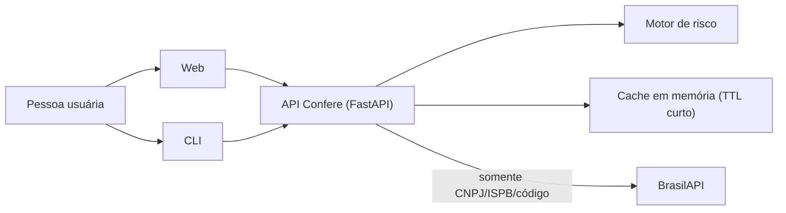

# Arquitetura

O Confere é uma camada fina sobre a BrasilAPI. A API guarda as regras (validação, risco, cache, limite de taxa); a interface web e a CLI são clientes dela, sem duplicar regra.

## Pastas

| Pasta | Conteúdo |
|---|---|
| `api/` | API em Python (FastAPI): cliente BrasilAPI, validação, motor de risco |
| `web/` | Interface web (M2) |
| `cli/` | Linha de comando (Typer): cliente fino da API |
| `website/` | Esta documentação (Docusaurus, pt-BR e inglês) |
| `.lgpd/` | Artefatos de conformidade com a LGPD (em português, por ser lei brasileira) |

## Decisões

- **Sem banco de dados**: nada é persistido. O cache é só memória e expira sozinho.
- **Somente identificadores vão à BrasilAPI**: o IP da pessoa usuária nunca é repassado.
- **Web sem terceiros**: Vite + React, sem CDN nem fontes externas, CSP restritiva no build, só `/v1/*` na mesma origem (proxy). O navegador guarda apenas o idioma.
- **Regras de risco explicáveis**: cada sinal tem código, texto e peso; não há modelo opaco.
