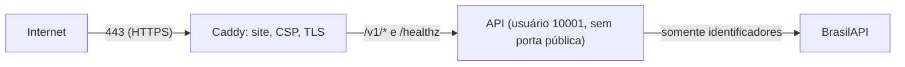

# Implantação

## Visão geral

A implantação usa dois contêineres: a **API** (sem porta publicada) e o **Caddy**, que serve o site, faz o HTTPS automático e encaminha só `/v1/*` e `/healthz` para a API. Nada é persistido além dos certificados do Caddy.




## Requisitos

Um servidor com Docker e Docker Compose, um domínio apontando para ele e as portas 80 e 443 abertas (para o certificado automático). Não há segredos, banco de dados nem contas.

## Passo a passo

```bash
cd deploy
cp .env.example .env     # edite CONFERE_DOMAIN e CONFERE_ACME_EMAIL
docker compose up -d --build
docker compose ps
```

Use um **e-mail dedicado** do projeto em `CONFERE_ACME_EMAIL`, nunca um e-mail pessoal.


## Variáveis

| Variável | Padrão | Para quê |
|---|---|---|
| `CONFERE_DOMAIN` | obrigatória | Domínio público (e do certificado) |
| `CONFERE_ACME_EMAIL` | `nobody@example.invalid` | Conta ACME do Let's Encrypt (e-mail dedicado) |
| `CONFERE_LIMITE_POR_MINUTO` | `30` | Consultas por origem |
| `CONFERE_CACHE_TTL*` | `600` / `86400` | Validade dos caches em memória |
| `CONFERE_SNAPSHOT_MAX_DIAS` | `14` | Idade máxima da cópia local dos dados abertos usada sem rede |
| `CONFERE_HTTP_PORT`, `CONFERE_HTTPS_PORT` | `80`, `443` | Portas no hospedeiro (para testes locais) |

## Segurança da implantação

| Medida | Como |
|---|---|
| Usuário sem privilégio | Ambos os contêineres rodam como UID 10001, sistema de arquivos somente leitura, `cap_drop: ALL`, `no-new-privileges` |
| Imagem enxuta | A API não tem `pip` nem `setuptools`; pacotes do sistema atualizados; varredura Trivy na CI |
| CSP e cabeçalhos | CSP `default-src 'none'` (só o próprio site), HSTS, `nosniff`, `Referrer-Policy: no-referrer`, `Permissions-Policy` e sem `Server` |
| Proxy confiável | O Caddy sobrescreve o `X-Forwarded-For` com o IP real; a API usa o último valor (`CONFERE_CONFIAR_PROXY`) |
| Limites | Corpo de até 16 KB, tempos limite de leitura, limite de taxa por origem |
| Swagger desligado | `/docs` (que usa CDN) não existe em produção |


## Verificar

O `deploy/smoke.sh` confere saúde, SPA, cabeçalhos, API, o limite de taxa contra `X-Forwarded-For` falso e a **privacidade dos logs**. As mensagens do script estão em português.


## Privacidade em operação

O log do Caddy não registra acessos, e os erros saem sem IP, URL nem cabeçalhos. O log da API registra só método, modelo da rota (`/v1/cnpj/{cnpj}/check`), status e tempo, nunca CNPJ, busca ou IP.


## Antes de anunciar uma instância pública

Preencha `.lgpd/instancia-modelo.md` (controlador, endereço, e-mail dedicado, hospedagem) e a política v1.1. Se a instância for de pessoa jurídica com atividade econômica, avalie o artigo 15 do Marco Civil (registros de acesso por 6 meses), que colide com "sem IP em log".

## Atualizar e operar

```bash
git pull && docker compose up -d --build
```

Não há dados para fazer backup: só os certificados do Caddy (volume `caddy_data`), que são emitidos de novo se faltarem. A Dependabot abre PRs semanais para dependências, imagens e ações do CI.
