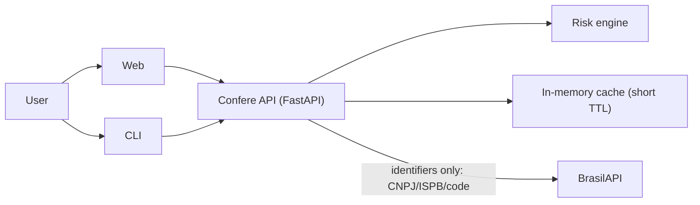

# Architecture

Confere is a thin layer over BrasilAPI. The API holds the rules (validation, risk, cache, rate limiting); the web interface and the CLI are its clients, with no duplicated rules.

## Folders

| Folder | Content |
|---|---|
| `api/` | Python API (FastAPI): BrasilAPI client, validation, risk engine |
| `web/` | Web interface (M2) |
| `cli/` | Command line (Typer): thin API client |
| `website/` | This documentation (Docusaurus, pt-BR and English) |
| `deploy/` | Dockerfiles, Compose, Caddyfile and `smoke.sh` |
| `.lgpd/` | LGPD compliance artifacts (in Portuguese, as it is Brazilian law) |

## Decisions

- **No database**: nothing is persisted. The cache is memory-only and expires by itself.
- **Only identifiers go to BrasilAPI**: the user's IP is never forwarded.
- **Web with no third parties**: Vite + React, no CDN or external fonts, restrictive CSP in the build, only `/v1/*` on the same origin (proxy). The browser only stores the language.
- **Explainable risk rules**: every signal has a code, a text and a weight; there is no opaque model.
