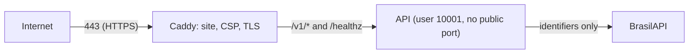

# Deployment

## Overview

The deployment uses two containers: the **API** (no published port) and **Caddy**, which serves the site, handles automatic HTTPS and forwards only `/v1/*` and `/healthz` to the API. Nothing is persisted except Caddy's certificates.




## Requirements

A server with Docker and Docker Compose, a domain pointing to it and ports 80 and 443 open (for the automatic certificate). There are no secrets, database or accounts.

## Step by step

```bash
cd deploy
cp .env.example .env     # edit CONFERE_DOMAIN and CONFERE_ACME_EMAIL
docker compose up -d --build
docker compose ps
```

Use a **dedicated project e-mail** in `CONFERE_ACME_EMAIL`, never a personal one.


## Variables

| Variable | Default | Purpose |
|---|---|---|
| `CONFERE_DOMAIN` | required | Public domain (and certificate name) |
| `CONFERE_ACME_EMAIL` | `nobody@example.invalid` | Let's Encrypt ACME account (dedicated e-mail) |
| `CONFERE_LIMITE_POR_MINUTO` | `30` | Lookups per origin |
| `CONFERE_CACHE_TTL*` | `600` / `3600` / `86400` | In-memory cache lifetimes |
| `CONFERE_HTTP_PORT`, `CONFERE_HTTPS_PORT` | `80`, `443` | Host ports (for local tests) |

## Deployment security

| Measure | How |
|---|---|
| Unprivileged user | Both containers run as UID 10001, read-only filesystem, `cap_drop: ALL`, `no-new-privileges` |
| Lean image | The API has no `pip` or `setuptools`; OS packages updated; Trivy scan in CI |
| CSP and headers | CSP `default-src 'none'` (own site only), HSTS, `nosniff`, `Referrer-Policy: no-referrer`, `Permissions-Policy` and no `Server` |
| Trusted proxy | Caddy overwrites `X-Forwarded-For` with the real IP; the API uses the last value (`CONFERE_CONFIAR_PROXY`) |
| Limits | Body up to 16 KB, read timeouts, per-origin rate limit |
| Swagger off | `/docs` (which uses a CDN) does not exist in production |


## Verify

`deploy/smoke.sh` checks health, the SPA, headers, the API, the rate limit against a fake `X-Forwarded-For` and **log privacy**. The script messages are in Portuguese.


## Privacy in operation

Caddy's log records no accesses, and errors come out without IP, URL or headers. The API log records only method, route template (`/v1/cnpj/{cnpj}/check`), status and time, never a CNPJ, a search or an IP.


## Update and operate

```bash
git pull && docker compose up -d --build
```

There is no data to back up: only Caddy's certificates (the `caddy_data` volume), which are issued again if missing. Dependabot opens weekly PRs for dependencies, images and CI actions.
